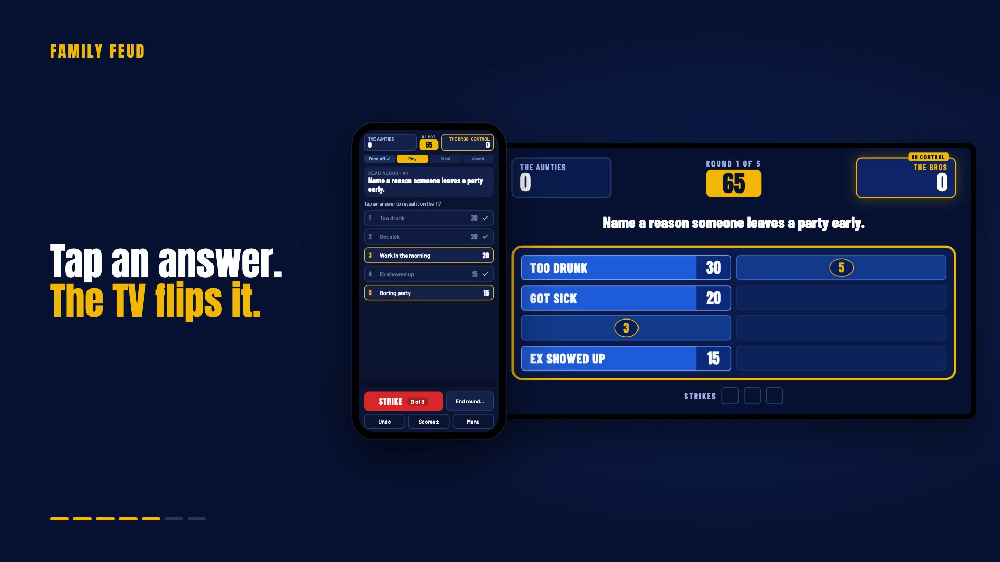
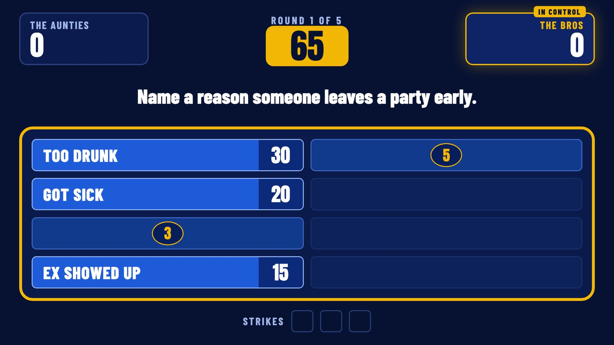
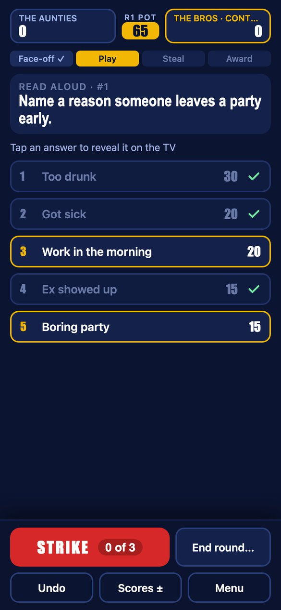
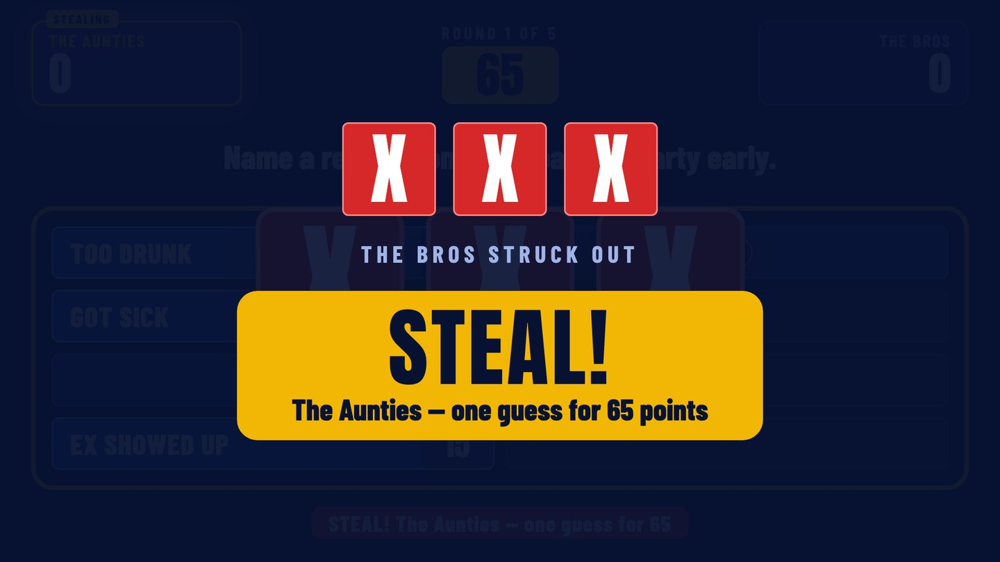
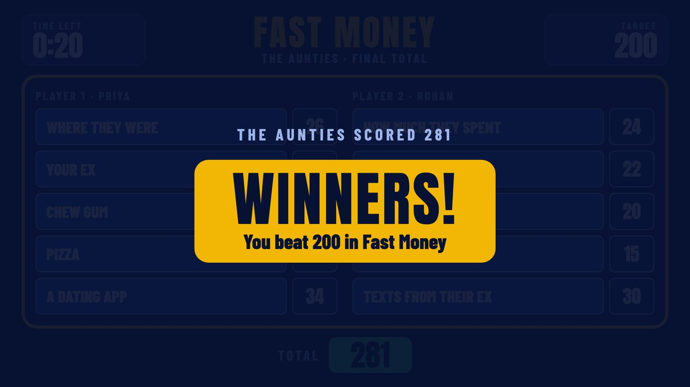

# Family Feud

**The hit TV game show, recreated for game night with friends.**
The TV shows the board. Your phone runs the show.

[](docs/family-feud-launch.mp4)

<sub>▶ 36-second launch video, recorded from the real app.</sub>

## What it does

- **Two screens, live.** A laptop plugged into the TV shows the game board. The host runs every round from their phone, and each tap lands on the TV instantly.
- **Join with a QR code.** The TV's start screen shows a QR code; scan it and you're the host. No app to install.
- **Face-offs that settle themselves.** Tap who buzzed in and what each team answered. The #1 answer wins outright; otherwise the higher answer wins, and the TV asks the winners to play or pass.
- **Strikes and steals.** Three strikes slam red X's onto the TV and hand the other team one guess to steal the pot.
- **Fast Money.** Two players, five questions, 20 and 25 second clocks, Player 1's answers hidden while Player 2 plays, and a duplicate buzzer.
- **40 survey questions** with answers and points, filtered Classic, Funny or Spicy.
- **Host safety nets:** Undo, score fixes, adjustable round count, a "hide the board" switch, and a rejoin QR code if the host's phone drops off.

| TV board | Host phone |
|---|---|
|  |  |
|  |  |

## How it works

```
             ┌──────────── laptop (node server.js) ────────────┐
             │  game state  ·  rules  ·  undo history          │
             └───────▲───────────────────────────┬─────────────┘
       taps (POST)   │                           │  live state (Server-Sent Events)
             ┌───────┴────────┐          ┌───────▼────────┐
             │  phone /host   │          │   TV /board    │
             │  host controls │          │  game board    │
             └────────────────┘          └────────────────┘
```

One small Node server with no dependencies holds the game and its rules. The phone sends each action, the server updates the game and pushes the new state to every screen over Server-Sent Events. The board only receives answers once they're revealed, so nobody can peek from the laptop.

## Run it

You need Node.js 18+ and a laptop connected to the TV. The phone and laptop must be on the same Wi-Fi.

```bash
git clone https://github.com/Shlokbum/family-feud.git
cd family-feud
./start.sh
```

`start.sh` starts the server, keeps the Mac awake and opens the board. Click the board once to turn on sound and full screen, then scan the QR code with your phone. (On other systems, run `node server.js` and open `http://localhost:3000/board`.)

## Make it yours

The questions live in [`questions.json`](questions.json). Each one is a question, a type (`classic`, `funny` or `spicy`) and its answers with points, highest first:

```json
{ "id": 1, "type": "funny", "question": "Name a reason someone leaves a party early.",
  "answers": [["Too drunk", 30], ["Got sick", 20], ["Work in the morning", 20], ["Ex showed up", 15], ["Boring party", 15]] }
```

[`question-bank.md`](question-bank.md) is a printable list of all 40.

## How the launch video was made

There are no mockups in the video. [`promo/video/record.js`](promo/video/record.js) starts a demo copy of the game, opens [`stage.html`](promo/video/stage.html) in headless Chrome at 1920×1080, and plays a scripted game by tapping the real buttons on the phone screen while the TV board reacts live. It records the screen and encodes the MP4.

```bash
cd promo && npm install && npm run record
```

It expects Google Chrome at its standard macOS location.

## Built with

Node.js · Server-Sent Events · vanilla HTML, CSS and JavaScript · Web Audio for the sound effects · built with [Claude Code](https://claude.com/claude-code).

---

A fan project for parties, not affiliated with Family Feud, Fremantle or its broadcasters. Released under the [MIT License](LICENSE).
